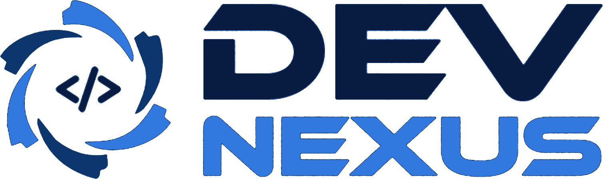

<h1 align="center">Olá, eu sou o Gustavo 👋</h1>

  <b>Estudante de Análise e Desenvolvimento de Sistemas na Unoeste</b> 
  Sistemas em C · Front-end com Bootstrap · Dados com Power BI · Liderança de projeto

  
  
  
  

---

## 🙋‍♂️ Sobre mim

Estou no **2º termo de Análise e Desenvolvimento de Sistemas** na Unoeste e trabalho no setor de transporte da **Usina Cocal**. Lá eu lanço apontamentos de manutenção no **TOTVS PIMS**, confiro os dados no **Power BI** e monto os relatórios do turno. Esse contato diário com dados foi o que me puxou para a tecnologia: gosto de pegar uma informação bagunçada e transformar em algo que alguém consegue usar para decidir.

Na faculdade, sou o **líder de projeto (Scrum Master)** de uma equipe de **8 integrantes**. Divido as tarefas, acompanho os prazos, junto o código de todo mundo em uma entrega só e escrevo a documentação técnica. Também programo: em **C** no sistema desktop e em **HTML, CSS, JavaScript e Bootstrap** no site.

- 🎯 Procurando **estágio em TI** (Presidente Prudente e região)
- 📄 Escrevo documentação de verdade: ERS pela **IEEE 830**, relatórios de instruções e roteiros de teste
- 🤖 Nas horas vagas, crio **bots para Discord**
- 💬 Pode me chamar para falar de C, organização de equipe ou Power BI

---

## 🚀 Projeto em destaque

  
  &nbsp;&nbsp;&nbsp;&nbsp;
  <a href="https://github.com/DevNexus-ProjectAlpha"><picture><source media="(prefers-color-scheme: dark)" srcset="devnexus-empilhada.png"></picture></a>

  <b>Project Alpha</b> · solução completa para uma academia em Presidente Prudente – SP 
  Projeto Integrador da Unoeste, feito pela equipe <b>DevNexus</b> (8 integrantes) · <b>nota 10</b> na avaliação final

<table>
  <tr>
    <td width="50%" valign="top">
      <h3>💻 <a href="https://github.com/DevNexus-ProjectAlpha/Project-alpha-Sistema-Desktop">Sistema Desktop</a></h3>
      
Gestão interna da academia em <b>linguagem C</b>, com os dados gravados em <b>arquivos binários</b>.

      <ul>
        <li>Cadastros de 9 entidades, com alterar, excluir e consultar</li>
        <li>Matrícula, recebimento e cancelamento com cálculo de retenção</li>
        <li>Frequência, financeiro e 7 relatórios com filtros</li>
        <li>Histórico de versões V1.0 → V3.5 em commits</li>
      </ul>
      
<b>Minha parte:</b> estrutura base, integração do código da equipe, recebimento, cancelamento, frequência, financeiro, agenda, relatórios e a base de dados de teste.

    </td>
    <td width="50%" valign="top">
      <h3>🌐 <a href="https://github.com/DevNexus-ProjectAlpha/Project-alpha-Bootstrap">Website</a></h3>
      
Site da academia em <b>HTML, CSS, JavaScript e Bootstrap 5</b>, no ar em <a href="https://www.projectalpha.com.br">projectalpha.com.br</a>.

      <ul>
        <li>Matrícula online com escolha de plano e cálculo do valor</li>
        <li>Validação e máscaras de formulário, CEP pela API ViaCEP</li>
        <li>Dashboard de avaliações físicas com IMC e relatório</li>
        <li>Widget de acessibilidade e VLibras</li>
      </ul>
      
<b>Minha parte:</b> dashboard, matrícula e planos, acessibilidade, organização do repositório e deploy na Vercel com domínio próprio.

    </td>
  </tr>
</table>

Antes disso, no **Projeto Integrado I**, a equipe criou a identidade visual e os protótipos de interface do Project Alpha.

---

## 🛠️ Tecnologias

**Linguagens e web**

  
  
  
  
  
  

**Ferramentas**

  
  
  
  
  
  

**Dados e sistemas de gestão**

  
  
  

**Bots para Discord**

  

**Próximo passo**

  

---

  <i>Organizando a informação, um commit de cada vez.</i> 
  Aberto a feedbacks, sugestões e novas conexões.

